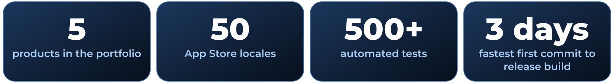
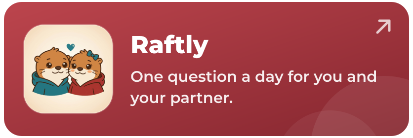

  <picture><source media="(max-width: 700px)" srcset="https://raw.githubusercontent.com/binerlabs/.github/main/profile/assets/banner-narrow.svg?v=88a7e902"></picture>

<h2 align="center">
  We build products that solve everyday problems
</h2>

  Biner Labs is a software factory focused on native Apple apps. Each product starts with a problem people run into and goes through one shared production pipeline, so what we learn on one carries into the next. Today we build for iPhone and iPad in Swift and SwiftUI.

  <picture><source media="(max-width: 700px)" srcset="https://raw.githubusercontent.com/binerlabs/.github/main/profile/assets/stats-narrow.svg?v=1be712bb"></picture>

<h3 align="center">
  Portfolio
</h3>

  <a href="https://gillow.binerlabs.com/"><picture><source media="(max-width: 700px)" srcset="https://raw.githubusercontent.com/binerlabs/.github/main/profile/assets/card-gillow.svg?v=8459b6f2"></picture></a>
  
  
  
  

<h3 align="center">
  How the factory works
</h3>

  <picture><source media="(max-width: 700px)" srcset="https://raw.githubusercontent.com/binerlabs/.github/main/profile/assets/pipeline-narrow.svg?v=18d46184"></picture>

  Every product follows the same 22 steps, from the first brief to App Store listings. A release has to pass automated tests before it goes out.

  <a href="https://github.com/ranggabiner"><b>ranggabiner</b></a>

