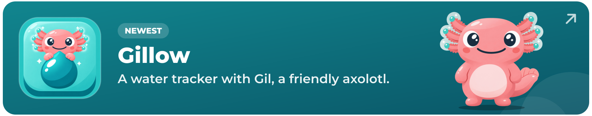
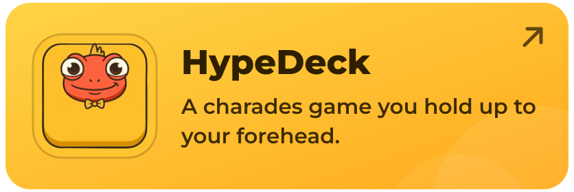

  

  <a href="https://gillow.binerlabs.com/"><picture><source media="(max-width: 700px)" srcset="https://raw.githubusercontent.com/binerlabs/.github/main/profile/assets/card-gillow.svg?v=f56c0bcb"></picture></a>
  
  
  
  

made by rangga &amp; claude

