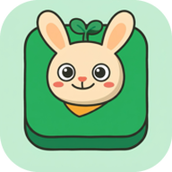

Here's what we're working on.

<table>
  <tr>
    <td width="104" align="center"></td>
    <td><a href="https://hypedeck.binerlabs.com/"><b>HypeDeck</b></a> A charades party game. Hold your phone to your forehead and guess the card before the clock runs out.</td>
  </tr>
  <tr>
    <td width="104" align="center"></td>
    <td><a href="https://raftly.binerlabs.com/"><b>Raftly</b></a> One question a day for you and your partner. Their answer opens once you've answered too.</td>
  </tr>
  <tr>
    <td width="104" align="center"></td>
    <td><a href="https://runbloom.binerlabs.com/"><b>Runbloom</b></a> Every run grows a plant in your own garden.</td>
  </tr>
  <tr>
    <td width="104" align="center"></td>
    <td><a href="https://lightjar.binerlabs.com/"><b>Lightjar</b></a> Short, kind quotes picked for how you feel, on your Home Screen and Lock Screen.</td>
  </tr>
</table>

Need help with one of these apps? Each website has a support page.
